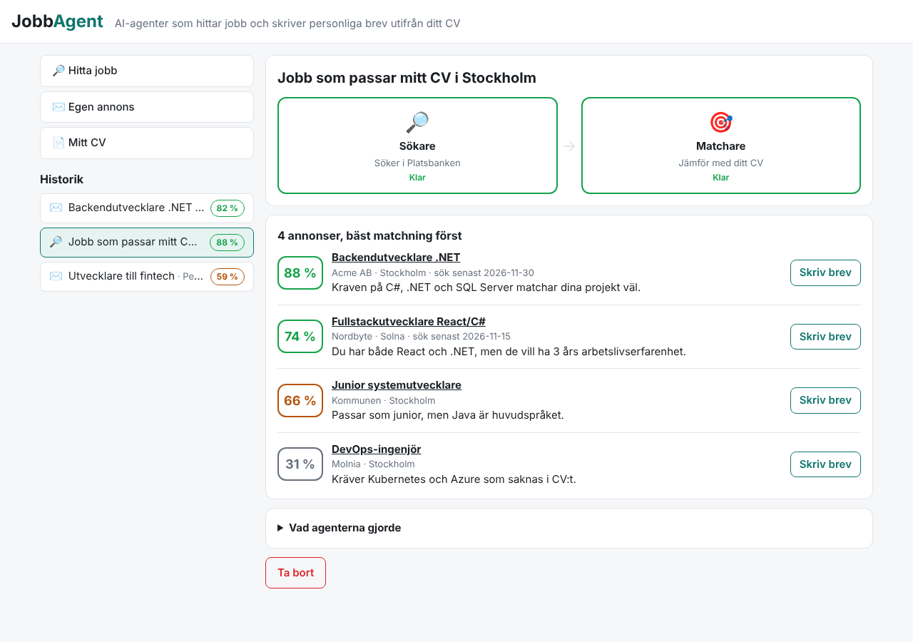
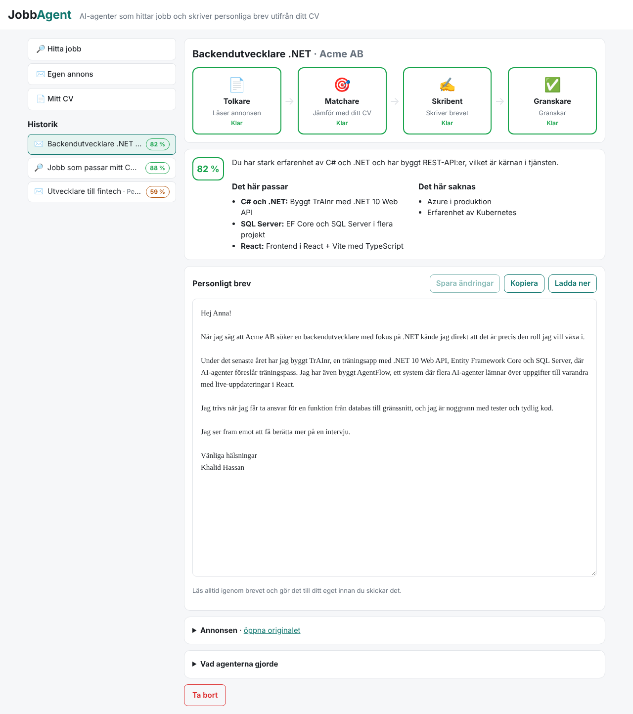
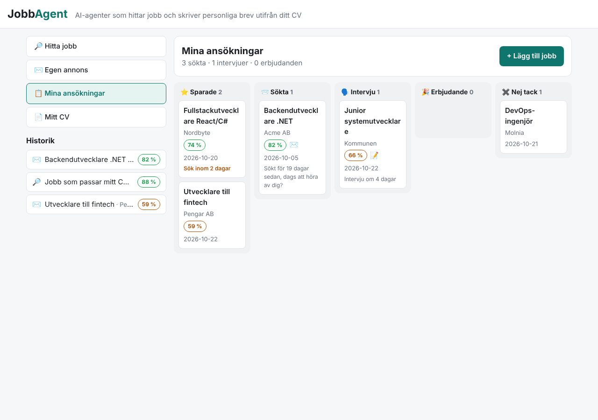
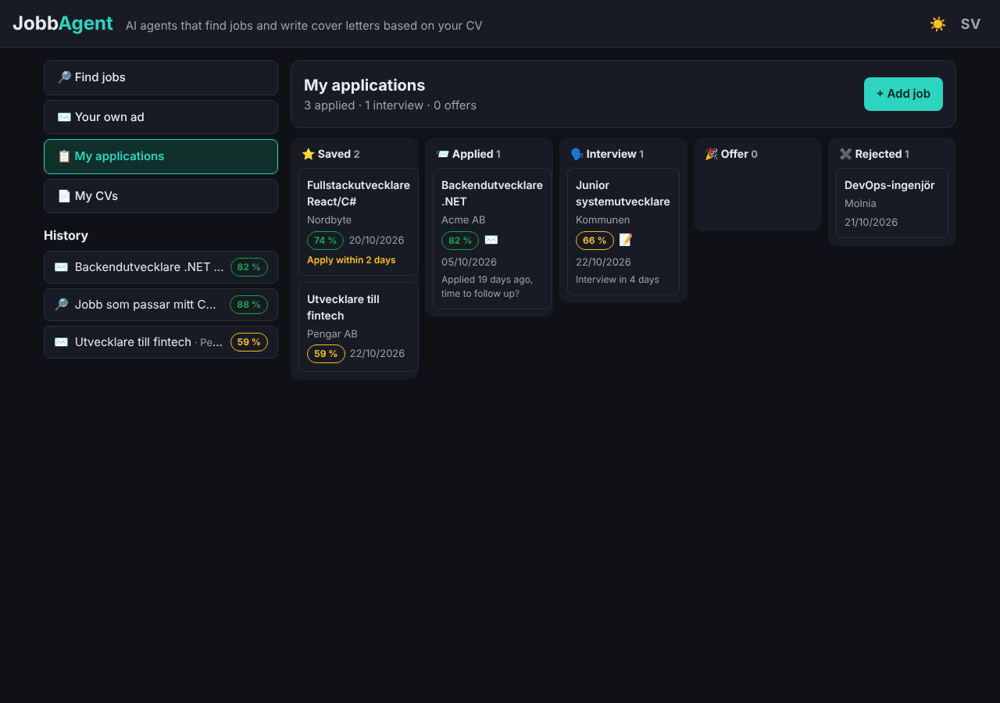

# JobbAgent

AI-agenter som hjälper dig att söka jobb. De letar upp annonser som passar ditt CV, visar hur väl du matchar
varje annons och skriver ett personligt brev som bara bygger på det som faktiskt står i ditt CV.



## Två sätt att använda den

**🔎 Hitta jobb åt mig.** Ange gärna ort, egna sökord och om du vill jobba på distans. Sökaren läser ditt CV,
tar fram sökord och söker i Arbetsförmedlingens Platsbanken. Matcharen ger varje annons en poäng (0–100 %)
och en kort motivering. Klicka på *Skriv brev* vid den annons du vill söka.

**✉️ Egen annons.** Klistra in en länk eller själva annonstexten. Platsbanken-länkar läses via
Arbetsförmedlingens API; andra sidor hämtas och görs om till text. Om sidan kräver inloggning (t.ex. LinkedIn)
klistrar du in texten i stället.

Brevet kan du redigera, spara, kopiera och ladda ner som **Word eller PDF** med ditt namn och dina
kontaktuppgifter överst. Allt sparas i historiken.



## Mer som hjälper dig i jobbsökandet

- **📋 Ansökningstavla.** Spara jobb från en sökning eller ett brev och dra dem mellan *Sparade → Sökta →
  Intervju → Erbjudande / Nej tack*. Lägg till datum och anteckningar. Kortet påminner dig om sista
  ansökningsdag, kommande intervju och när det är dags att höra av sig.
- **🗣️ Intervjuförberedelse.** Intervjucoachen tar fram 8–10 troliga frågor med tips och exempelsvar ur ditt
  CV, frågor du kan ställa själv och hur du ärligt bemöter det som saknas. Övningsläget döljer svaren.
- **📝 CV-tips per annons.** Matcharen föreslår hur du kan anpassa CV:t för just det jobbet, utan att hitta på
  något nytt.
- **🔔 Bevakning.** Spara en sökning så körs den automatiskt varje morgon från klockan 7. Nya annonser som
  matchar minst den nivå du valt (t.ex. 70 %) markeras som *Ny*.
- **📄 Flera CV.** Spara t.ex. ett CV för utvecklarjobb och ett för lagerjobb och välj vilket agenterna ska
  använda för varje sökning, brev och bevakning.
- **🌙 Engelska och mörkt läge.** Byt språk (SV/EN) och tema uppe till höger. På engelska skriver även agenterna
  sina analyser och steg på engelska. Brevets språk väljer du separat.





## Agenterna

| Agent | Gör | Lämnar över till |
|---|---|---|
| 🔎 **Sökare** | Tar fram 1–3 sökfraser ur CV:t och söker i Platsbanken (gratis API, ingen nyckel). | Matchare: upp till 15 annonser |
| 📄 **Tolkare** | Plockar ut krav, meriter, arbetsuppgifter, personliga egenskaper och kontaktperson ur annonsen. | Matchare: kraven |
| 🎯 **Matchare** | Rankar sökträffar, eller går igenom en annons krav för krav: vad som passar, vad som saknas och vad brevet ska lyfta fram. | Skribent: analysen |
| ✍️ **Skribent** | Skriver brevet (250–400 ord) på svenska eller engelska. Hittar inte på något som inte står i CV:t. | Granskare: brevet |
| ✅ **Granskare** | Kontrollerar brevet mot CV:t och annonsen: påhittade meriter, missade krav, fel språk, platshållare. | Skribent igen (högst en gång) |
| 🗣️ **Intervjucoach** | Troliga intervjufrågor med tips och exempelsvar, frågor att ställa och hur du hanterar luckor. | – |

```
Sökning:  CV → Sökare → Platsbanken → Matchare → Topplista ──┐
                                                             │ "Skriv brev"
Brev:     Annons → Tolkare → Matchare → Skribent → Granskare → Personligt brev
                                           ↑          │
                                           └──────────┘  (om brevet underkänns)

Intervju: Annons → Tolkare → Matchare → Intervjucoach  (kraven och matchningen från brevet återanvänds)
```

Orkestreraren (`backend/JobbAgent.Api/Services/RunOrchestrator.cs`) styr ordningen. Varje steg sparas i
SQL Server och skickas live till webbläsaren med Server-Sent Events.

## Teknik

- **Backend:** .NET 10 Minimal API, EF Core, SQL Server, bakgrundskö för körningar
- **AI:** Groq (`openai/gpt-oss-120b`) med structured outputs (JSON-schema genererat från C#-records)
- **Jobbannonser:** [JobSearch API](https://jobsearch.api.jobtechdev.se) från Arbetsförmedlingen/JobTech
- **CV:** PDF (PdfPig), Word (.docx) eller vanlig text
- **Brev som fil:** Word (.docx) och PDF (PdfPig med inbäddat typsnitt, Caladea under OFL)
- **Frontend:** React 19 + Vite + TypeScript
- **Drift:** Docker Compose, GitHub Actions kör tester på varje pull request

## Kom igång (Windows)

1. Installera [Docker Desktop](https://www.docker.com/products/docker-desktop/) och hämta koden:
   `git clone https://github.com/Khalid1754/JobbAgent.API.git`
2. Dubbelklicka på `start.bat`. Första gången skapas `.env` och öppnas i Anteckningar:
   lägg in din `GROQ_API_KEY` (gratis på https://console.groq.com/keys), spara och kör `start.bat` igen.
3. Appen öppnas på http://localhost:8100. Börja med att ladda upp ditt CV under *Mina CV*.
   `stopp.bat` stoppar appen.

Eller i PowerShell:

```powershell
copy .env.example .env   # och fyll i GROQ_API_KEY
docker compose up -d --build
```

Portarna (8100, 5108, 1435) skiljer sig från TrAInr och AgentFlow, så alla kan köras samtidigt.

## Utveckla lokalt

```powershell
docker compose up -d sqlserver
cd backend/JobbAgent.Api
dotnet user-secrets init; dotnet user-secrets set Groq:ApiKey <din-nyckel>
dotnet run                      # API på http://localhost:5108
cd ../../frontend
npm install; npm run dev        # http://localhost:5173
```

Tester: `dotnet test JobbAgent.slnx` och `npm test` i `frontend`.

## API

| Metod | Sökväg | Beskrivning |
|---|---|---|
| `GET` | `/api/cvs` | Dina CV |
| `POST` | `/api/cvs` | Nytt CV, `{ "name": "Utvecklare", "cvText": "...", "fullName": "...", "email": "..." }` |
| `PUT` | `/api/cvs/{id}` | Sparar ett CV |
| `POST` | `/api/cvs/upload` | Nytt CV från fil (`file`, PDF/.docx/.txt, max 5 MB); `/api/cvs/{id}/upload` ersätter texten |
| `POST` | `/api/cvs/{id}/default` | Gör CV:t till standard |
| `DELETE` | `/api/cvs/{id}` | Tar bort ett CV (minst ett finns kvar) |
| `POST` | `/api/searches` | Startar en jobbsökning, `{ "location": "Stockholm", "keywords": "", "remoteOnly": false, "cvId": null }` |
| `POST` | `/api/letters` | Startar ett brev, `{ "adUrl": "..." }`, `{ "adText": "..." }` eller `{ "platsbankenId": "..." }`, plus `language`: `auto`, `sv` eller `en` |
| `POST` | `/api/interviews` | Startar en intervjuförberedelse, `{ "letterRunId": "..." }` eller `{ "applicationId": "..." }` |
| `GET` | `/api/runs` | Historiken (sökningar, brev och intervjuer) |
| `GET` | `/api/runs/{id}` | En körning med alla steg och resultat |
| `GET` | `/api/runs/{id}/events` | Server-Sent Events: alla steg, sedan nya live |
| `PUT` | `/api/runs/{id}/letter` | Sparar ändringar i brevet |
| `GET` | `/api/runs/{id}/letter.docx`, `letter.pdf` | Brevet som Word eller PDF |
| `DELETE` | `/api/runs/{id}` | Tar bort en färdig körning |
| `GET`, `POST` | `/api/applications` | Ansökningstavlan; `POST` med `{ "letterRunId": "..." }` eller titel, företag, länk m.m. |
| `PUT`, `DELETE` | `/api/applications/{id}` | Ändrar steg, datum och anteckningar, eller tar bort jobbet |
| `GET`, `POST` | `/api/watches` | Bevakningar, `{ "location": "...", "keywords": "...", "minScore": 70, "cvId": null }` |
| `PUT`, `DELETE` | `/api/watches/{id}` | Ändrar, pausar eller tar bort en bevakning |
| `POST` | `/api/watches/{id}/run` | Kör bevakningen direkt |
| `GET` | `/api/status` | Om AI-nyckeln och CV:t är inlagda |

Skicka `Accept-Language: en` för felmeddelanden och agenternas steg på engelska (svenska är standard).

## Integritet

Ditt CV och dina brev sparas bara i din egen SQL Server-databas. CV:t och annonsen skickas till Groq när
agenterna jobbar.
